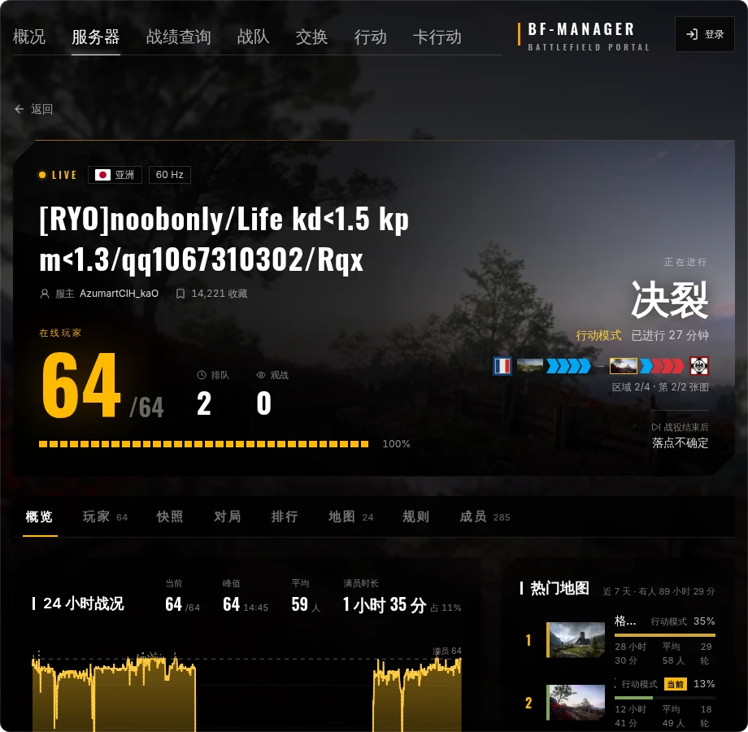
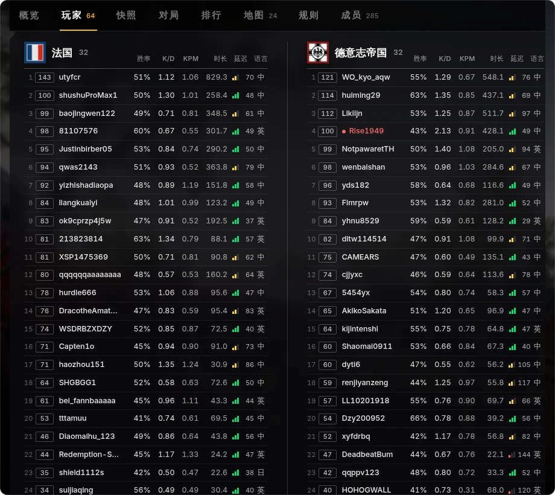
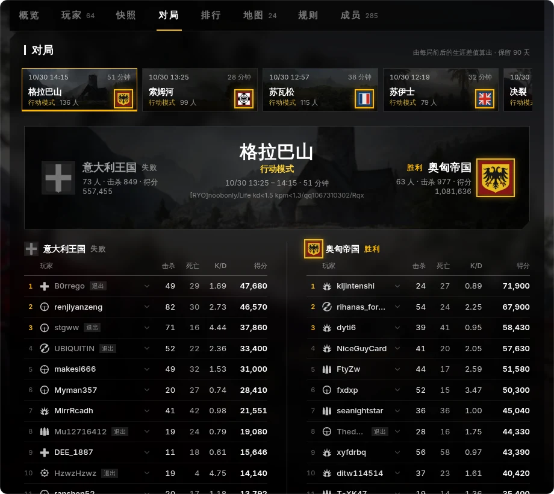
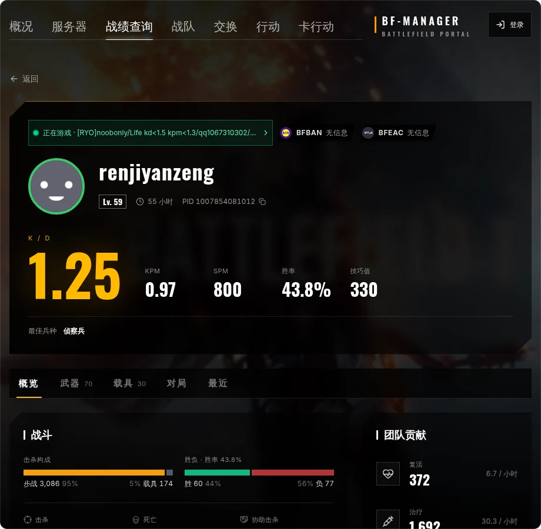
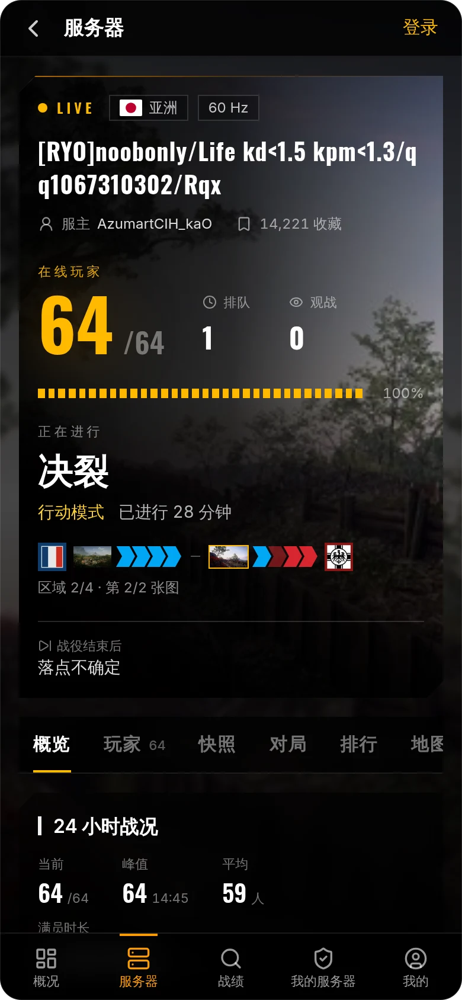
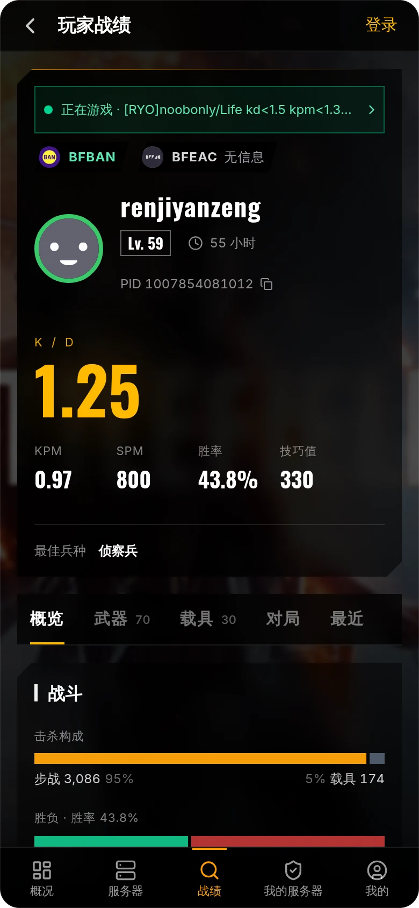
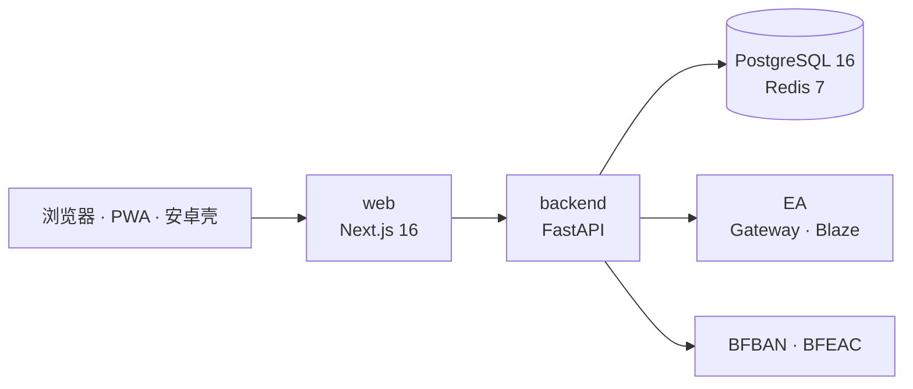

# BF-Manager

Battlefield 1 的战绩查询与私服管理平台。玩家查生涯、武器和每一局的表现，服主在网页上看实时名单、踢人封禁、换图、发计时 VIP，所有管理操作都留审计记录。桌面和手机共用一套界面，也可以装到桌面当 App 用。

[](https://github.com/g1331/bf-manager/actions/workflows/ci.yml)
[](https://github.com/g1331/bf-manager/releases)
[](LICENSE)

[功能](#功能) · [架构](#架构) · [本地开发](#本地开发) · [部署](#部署) · [发版](#发版) · [管理命令](#管理命令)

<br/>



<table>
  <tr>
    <td width="50%"></td>
    <td width="50%"></td>
  </tr>
  <tr>
    <td>在线名单：两队玩家连同生涯胜率、K/D、KPM、延迟一起列出</td>
    <td>对局：用进服与结算时的生涯差分算出每局战绩，保留 90 天</td>
  </tr>
  <tr>
    <td></td>
    <td></td>
  </tr>
  <tr>
    <td>服务器浏览器：按模式、地图、区域、空位筛选</td>
    <td>玩家战绩：生涯、武器、载具和对局，附封禁记录</td>
  </tr>
</table>

<p align="center">
  
  &nbsp;&nbsp;
  
</p>

## 功能

**查询**，匿名可用：

| 模块 | 内容 |
|---|---|
| 战绩 | 生涯数据、武器、载具、最近对局、在线状态；BFBAN 与 BFEAC 案件标记 |
| 服务器 | 浏览与筛选；详情页有实时名单、24 小时人数曲线、热门地图、常客排行、规则、成员 |
| 快照 | 每分钟记录私服名单，可回看任一时刻两队名单和进出 |
| 对局 | 每局两队计分板、个人击杀死亡得分，以及这一局用过的武器载具 |
| 战队、交换、行动 | 战队搜索与成员；交换含历史各期；行动战役进度 |

**服务器管理**，需要服管权限：

| 模块 | 内容 |
|---|---|
| 玩家操作 | 踢人、换边、封禁与解封、上下 VIP、增删管理员 |
| 地图 | 换图、重开当前图；行动服按编排自动换图 |
| 计时 VIP | 普通服到期自动下 V，行动服排队等生效时机 |
| 卡行动 | 服主提供自己的 EA 凭据，把私服卡成 24 图行动 |
| 审计 | 每次操作记录发起人、目标和结果；服管权限分 viewer / moderator / admin / owner 四级 |

**平台运维**，仅平台管理员：EA 查询号池（邮箱密码登录、失效检测）、发往 EA 的请求统计、开放 API Key 与额度、全站审计日志。

## 架构



后端进程里还跑着几项后台任务：全服扫描、私服快照与对局跟踪、交换换期、行动服自动换图、计时 VIP 到期处理。服务器名单和玩家战绩走 Blaze 长连接，服管命令和其余查询走 EA Gateway。EA 凭据用 AES-256-GCM 加密入库，不出现在任何接口响应里。

| 层 | 选型 |
|---|---|
| 前端 | Next.js 16 App Router、React 19、TypeScript、Tailwind v4、shadcn/ui、TanStack Query、Zustand |
| 后端 | FastAPI、SQLAlchemy 2.0 async、Alembic、Pydantic v2 |
| 数据 | PostgreSQL 16、Redis 7 |
| 工具链 | pnpm workspaces、uv、lefthook、git-cliff |
| 交付 | 多阶段 Dockerfile，镜像推送到 ghcr.io，Docker Compose 部署 |

```text
apps/
  web/        Next.js 前端
  backend/    FastAPI 后端
    app/domain/ea/           跨游戏共享：身份、persona、Blaze 协议
    app/domain/games/bf1/    BF1 专属：profile、gateway、字段 schema
    app/services/            业务编排
    app/api/v1/              路由
  android/    安卓壳 App（全屏 WebView）
packages/
  shared-types/   由后端 OpenAPI 生成的 TS 类型
tools/        部署、备份、类型生成、安卓打包脚本
```

代码按游戏分层，EA 身份层与具体游戏解耦。目前只实现了 BF1，接入其他游戏的步骤见 [`apps/backend/app/domain/games/README.md`](apps/backend/app/domain/games/README.md)。

## 本地开发

需要 Docker、Node.js 20+、pnpm 9、Python 3.12+、[uv](https://docs.astral.sh/uv/) 和 Make。

```bash
cp .env.example .env
make install      # 安装前后端依赖
make dev          # 起 postgres、redis、backend、web
make migrate      # 数据库迁移到最新
```

前端在 `http://localhost:3000`，后端在 `http://localhost:8000`，开发环境的接口文档在 `/docs`。

查询和服管功能要用 EA 账号去请求，开发时往号池里放一个：

```bash
docker compose exec backend uv run python tools/seed_ea_account.py \
    --persona-id <PERSONA_ID> --remid <REMID> --sid <SID>
```

只想看界面，可以不起 Docker：后端在 `apps/backend` 下执行 `uv run uvicorn app.main:app --reload`，默认用 SQLite；前端在 `apps/web` 下执行 `pnpm dev`。没有 EA 凭据时，在 `apps/backend/.env` 里设 `BLAZE_MOCK_MODE=true`，服务器玩家名单会返回内置的假数据。

后端 schema 改了之后，执行 `make gen-types` 重新生成前端类型（输出不进 git）。其他命令见 `make help`。

## 部署

部署机只拉镜像、不本地构建。首次部署和日常更新都用同一个脚本：

```bash
git clone https://github.com/g1331/bf-manager.git && cd bf-manager
bash tools/deploy.sh               # 或 make deploy
bash tools/deploy.sh --tag v1.2.3  # 锁定版本
```

首次运行会生成 secrets、交互填写域名生成 `.env.prod`、拉镜像、启动服务并自动迁移；检测到没有管理员时，会引导创建第一个本地管理员。之后再跑就是拉新镜像滚动更新，可以重复执行。

backend 和 web 只监听 `127.0.0.1:8000` 与 `127.0.0.1:3000`，TLS 和反向代理交给宿主机上的 nginx 或 openresty。生产环境默认关闭接口文档，只对外提供 BF1 只读接口的 `/api/v1/openapi.public.json`。

EA 查询号池单独录入，凭据从标准输入读：

```bash
docker compose --env-file .env.prod -f docker-compose.prod.yml exec backend \
    python -m app.cli upsert-ea-account --persona-id <PERSONA_ID> --stdin-json
```

## 发版

版本号只来自 git tag。源码里的 `version` 字段一直是 `0.0.0`，CI 构建时按 tag 注入，发版不产生改版本号的提交。

```bash
git checkout main && git pull
git tag -a v1.2.3 -m "Release v1.2.3"
git push origin v1.2.3
```

`release.yml` 会构建并推送 `ghcr.io/g1331/bf-manager-{backend,web}:v1.2.3`，再用 git-cliff 按 Conventional Commits 生成 GitHub Release。tag 必须打在 main 的提交上。平时合并到 main 不用打 tag：CI 的检查全部通过后，才会构建 `main`、`latest` 和短 SHA 三个 tag 的镜像。回滚就是用 `deploy.sh --tag` 部署旧版本；数据库迁移不会自动回退，回滚前先确认 schema 兼容。变更记录看 [Releases](https://github.com/g1331/bf-manager/releases)。

## 管理命令

平台管理员不走环境变量，用 CLI 写进数据库：

```bash
docker compose exec backend python -m app.cli <command>
```

| 命令 | 作用 |
|---|---|
| `create-admin --username <name>` | 创建本地管理员，不需要绑定 EA |
| `grant-admin --persona <id>` | 把登录过本站的 EA 用户提为管理员 |
| `revoke-admin --persona <id>` | 撤销管理员 |
| `list-admins` | 列出所有管理员 |
| `reset-password --username <name>` | 重置本地密码 |
| `upsert-ea-account --persona-id <id> --stdin-json` | 新增或更新号池账号 |

需要密码的命令默认交互输入，脚本里用 `--password-stdin`。服管权限在网页的 `/admin/memberships` 授予，被授权的人需要先登录过一次。

## 贡献

欢迎提 Issue 和 PR。提交信息遵循 [Conventional Commits](https://www.conventionalcommits.org/)，提交前 lefthook 会跑 ruff 和 ESLint。

## License

[MIT](LICENSE) © 2026 g1331
